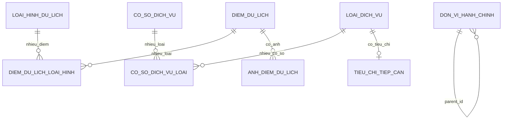

# TÀI LIỆU ĐẶC TẢ VÀ THIẾT KẾ CSDL KHÔNG GIAN TOURISMGIS

**Đề tài:** Xây dựng CSDL không gian quản lý các điểm du lịch, hỗ trợ tìm kiếm và phân tích khả năng tiếp cận dịch vụ.  
**Công nghệ:** PostgreSQL/PostGIS, QGIS, Node.js/Express, React/Leaflet.  
**Phiên bản thiết kế:** 1.0 (minh họa phục vụ bài tập lớn).  

## 1. Mục tiêu và phạm vi

Xây dựng mô hình dữ liệu có hình học POINT, MULTIPOLYGON, quan hệ N–N cho các danh mục, các chỉ mục GiST và câu truy vấn tìm kiếm, khoảng cách, vùng đệm, thống kê địa bàn, đánh giá tiếp cận và xác định khoảng trống dịch vụ. Giao diện WebGIS minh họa việc xử lý dữ liệu trực tiếp từ PostGIS qua API.

**Phạm vi:** Địa bàn thí điểm với dữ liệu đã kiểm chứng. Dữ liệu demo có nhãn *giả lập*, không phải thông tin du lịch thực địa.

## 2. Người dùng

- **Khách tham quan:** chỉ đọc bản đồ, tìm kiếm, phân tích và xem kết quả công khai.
- **Người quản trị dữ liệu:** thêm/sửa/xóa thông tin và tọa độ; biên tập danh mục, tiêu chí; cập nhật dữ liệu.
- **Người phân tích GIS:** phân tích và xuất kết quả; có thể gộp vai trò với quản trị trong phiên bản đầu.

Để triển khai nhiều người dùng thật, thiết kế xác thực/phân quyền và bảng nhật ký thay đổi trong mô-đun bổ sung, không cung cấp tài khoản mặc định công khai.

## 3. Yêu cầu chức năng và tiêu chí nghiệm thu

| Mã | Chức năng | Đầu vào | Xử lý chính | Đầu ra / tiêu chí chấp nhận |
|---|---|---|---|---|
| FR01 | CRUD điểm du lịch | mã, tên, điểm WGS84, thông tin | validate, INSERT/UPDATE/DELETE | Không trùng mã; thao tác lưu phản ánh trên bản đồ; xóa xâu chuỗi ảnh, liên kết loại hình |
| FR02 | Quản lý loại hình | tên/mã/diễn giải | danh mục và gán N–N | Một điểm có thể thuộc nhiều loại hình, không lặp cặp liên kết |
| FR03 | Quản lý dịch vụ | cơ sở, tọa độ, loại dịch vụ | danh mục + liên kết N–N | Một cơ sở có thể có nhiều loại dịch vụ, không nhân đôi trong đếm theo loại |
| FR04 | Quản lý PostGIS | dữ liệu GIS, CRS | kiểm tra SRID, hình học hợp lệ, import | POINT/MULTIPOLYGON SRID 4326, giá trị không gian hợp lệ |
| FR05 | WebGIS | lớp, mức zoom, bộ lọc | API GeoJSON, thao tác Leaflet | Hiển thị biểu tượng, popup, lớp và vùng đệm |
| FR06 | Tra cứu thuộc tính/vị trí | từ khóa/loại/địa bàn/tọa độ | ILIKE, EXISTS, ST_Covers, ST_DWithin | Trả kết quả và vị trí hình học tương ứng |
| FR07 | Khoảng cách 2 điểm | 2 mã địa điểm | ST_Distance(geography) | Kết quả là mét, không nhầm độ WGS84 |
| FR08 | Gần nhất/bán kính | tọa độ trung tâm, R, top K | ST_DWithin, ST_Distance | Không tính điểm gốc nếu truy vấn điểm gần nhất từ ID; giới hạn K |
| FR09 | Vùng đệm Buffer | ID và R | ST_Buffer(geography) | Trả Polygon WGS84 được vẽ đúng trên bản đồ |
| FR10 | Thống kê phân bố | loại hình / ranh giới | spatial join, GROUP BY | Biểu đồ, số lượng theo địa bàn; xử lý địa bàn không có điểm |
| FR11 | Khả năng tiếp cận | tiêu chí bán kính, mức tối thiểu | đếm cơ sở theo mỗi loại với ST_DWithin | Bảng đạt/chưa đạt và điểm tổng hợp 0–100 |
| FR12 | Khu vực thiếu dịch vụ | ranh giới, loại dịch vụ, R | hợp nhất buffer, ST_Difference, ST_Area | MultiPolygon vùng thiếu và diện tích km2 |

## 4. Yêu cầu phi chức năng

- **Tính toàn vẹn:** PK, FK, UNIQUE, CHECK, `NOT NULL`, kiểm tra kiểu hình học và SRID; kiểm tra chồng lấn ranh giới trước nhập chính thức.
- **Độ chính xác:** chỉ xuất bản tọa độ đã kiểm chứng; lưu nguồn và ngày xác minh; phân biệt bán kính Euclid/trắc địa với khoảng cách di chuyển theo đường.
- **Hiệu năng:** chỉ mục GiST cho geometry và biểu thức geography; kiểm tra với `EXPLAIN (ANALYZE, BUFFERS)`, đo tốc độ trên tập thực nghiệm.
- **Bảo mật:** CRUD chỉ dành cho người có quyền; API dùng câu truy vấn tham số hóa; không trả mật khẩu/tokens; kiểm soát CORS và rate limits khi triển khai Internet.
- **Tương tác:** API trả GeoJSON FeatureCollection với tọa độ WGS84 `[longitude, latitude]`.
- **Khả năng mở rộng:** đặt bảng trong schema `tourism`, tách dữ liệu danh mục, bảng liên kết và lớp hình học.

## 5. Quy ước về tọa độ và số đo

- `geom geometry(Point, 4326)` hoặc `geom geometry(MultiPolygon, 4326)` lưu dữ liệu nguồn.
- `ST_Distance(geom::geography, other_geom::geography)` trả đơn vị mét (theo spheroid mặc định).
- `ST_DWithin(geom::geography, center::geography, radius_m)` lọc trong bán kính bằng mét; ưu tiên so với tạo Buffer để lọc.
- `ST_Buffer(geom::geography, radius_m)::geometry` xây dựng vùng hiển thị có bán kính tính theo mét (dạng đa giác xấp xỉ).
- `ST_Area(polygon::geography) / 1000000.0` đổi m² sang km².
- Khi phân tích diện rộng/độ chính xác bản đồ, cân nhắc hệ quy chiếu phẳng thích hợp khu vực và báo cáo phương pháp so sánh.

## 6. Sơ đồ ERD

Nguồn chỉnh sửa: `04_so_do_ERD_tourismgis.mmd`; ảnh: `ERD_TourismGIS.png`.

**Giải thích quan hệ:**

1. `diem_du_lich` – `loai_hinh_du_lich`: quan hệ N–N qua `diem_du_lich_loai_hinh`.
2. `co_so_dich_vu` – `loai_dich_vu`: quan hệ N–N qua `co_so_dich_vu_loai`.
3. `loai_dich_vu` – `tieu_chi_tiep_can`: 1–0..1 (mỗi loại có tối đa 1 tiêu chí cấu hình trong phiên bản này).
4. `diem_du_lich` – `anh_diem_du_lich`: 1–N; xóa điểm xóa ảnh liên quan (chỉ là đường dẫn trong CSDL).
5. `don_vi_hanh_chinh` tự liên kết cha–con qua `parent_id`; **không** lưu FK địa bàn trong bảng điểm; suy ra bằng `ST_Covers` hoặc `ST_Contains` khi truy vấn.
6. Quan hệ giữa điểm du lịch và cơ sở gần nhất là quan hệ **động theo khoảng cách**, không phải FK.

## 7. Từ điển dữ liệu chi tiết

### 7.1 `tourism.don_vi_hanh_chinh`

| Trường | Kiểu | Ràng buộc / diễn giải |
|---|---|---|
| `id` | BIGINT IDENTITY | PK |
| `ma_dvhc` | VARCHAR(30) | NOT NULL, UNIQUE |
| `ten` | VARCHAR(200) | NOT NULL |
| `cap_hanh_chinh` | VARCHAR(25) | CHECK trong `tinh_thanh`, `xa_phuong`, `khu_vuc_khac` |
| `parent_id` | BIGINT | FK cùng bảng, RESTRICT; không tự làm cha |
| `nguon_du_lieu` | TEXT | NOT NULL |
| `geom` | geometry(MultiPolygon,4326) | NOT NULL, ST_IsValid, không rỗng; GiST |

Không tự động bảo đảm các Polygon không chồng lấn hoặc chu trình nhiều cấp parent; kiểm tra bằng truy vấn chất lượng dữ liệu hoặc trigger bổ sung khi cần.

### 7.2 `tourism.loai_hinh_du_lich`

| Trường | Kiểu | Ràng buộc / diễn giải |
|---|---|---|
| `id` | BIGINT IDENTITY | PK |
| `ma` | VARCHAR(30) | UNIQUE, NOT NULL |
| `ten` | VARCHAR(150) | UNIQUE, NOT NULL |
| `mo_ta` | TEXT | Tùy chọn |
| `is_active` | BOOLEAN | NOT NULL DEFAULT TRUE |

### 7.3 `tourism.diem_du_lich`

| Trường | Kiểu | Ràng buộc / diễn giải |
|---|---|---|
| `id` | BIGINT IDENTITY | PK |
| `ma` | VARCHAR(30) | UNIQUE, NOT NULL |
| `ten` | VARCHAR(250) | NOT NULL |
| `dia_chi`, `mo_ta` | TEXT | Tùy chọn |
| `gia_ve_vnd` | NUMERIC(12,0) | >= 0 hoặc NULL khi chưa biết |
| `gio_mo_cua` | JSONB | NOT NULL, JSON object; cấu trúc sâu cần xác thực ở API |
| `so_dien_thoai` | VARCHAR(25) | Tùy chọn |
| `website` | TEXT | Tùy chọn |
| `trang_thai` | VARCHAR(25) | CHECK các giá trị đã định nghĩa |
| `nguon_du_lieu` | TEXT | NOT NULL |
| `ngay_kiem_chung` | DATE | Tùy chọn |
| `geom` | geometry(Point,4326) | NOT NULL, tọa độ hợp lệ; GiST cho geometry/geography |
| `created_at`, `updated_at` | TIMESTAMPTZ | DEFAULT NOW(); update tự động qua trigger |

### 7.4 `tourism.diem_du_lich_loai_hinh`

| Trường | Kiểu | Ràng buộc / diễn giải |
|---|---|---|
| `diem_du_lich_id` | BIGINT | PK thành phần, FK → diem_du_lich, ON DELETE CASCADE |
| `loai_hinh_id` | BIGINT | PK thành phần, FK → loai_hinh_du_lich, ON DELETE RESTRICT |

### 7.5 `tourism.loai_dich_vu`

Cùng kiểu danh mục như `loai_hinh_du_lich`: `id BIGINT PK`, `ma VARCHAR(30) UNIQUE NOT NULL`, `ten VARCHAR(150) UNIQUE NOT NULL`, `mo_ta TEXT`, `is_active BOOLEAN DEFAULT TRUE`.

### 7.6 `tourism.co_so_dich_vu`

| Trường | Kiểu | Ràng buộc / diễn giải |
|---|---|---|
| `id` | BIGINT IDENTITY | PK |
| `ma` | VARCHAR(30) | UNIQUE, NOT NULL |
| `ten` | VARCHAR(250) | NOT NULL |
| `dia_chi` | TEXT | Tùy chọn |
| `so_dien_thoai` | VARCHAR(25) | Tùy chọn |
| `gio_mo_cua` | JSONB | JSON object, DEFAULT {} |
| `trang_thai` | VARCHAR(25) | CHECK các trạng thái hoạt động |
| `nguon_du_lieu` | TEXT | NOT NULL |
| `ngay_kiem_chung` | DATE | Tùy chọn |
| `geom` | geometry(Point,4326) | NOT NULL; GiST |
| `created_at`, `updated_at` | TIMESTAMPTZ | Mặc định NOW(); tự động cập nhật |

### 7.7 `tourism.co_so_dich_vu_loai`

| Trường | Kiểu | Ràng buộc / diễn giải |
|---|---|---|
| `co_so_dich_vu_id` | BIGINT | PK thành phần, FK → co_so_dich_vu, ON DELETE CASCADE |
| `loai_dich_vu_id` | BIGINT | PK thành phần, FK → loai_dich_vu, ON DELETE RESTRICT |

### 7.8 `tourism.tieu_chi_tiep_can`

| Trường | Kiểu | Ràng buộc / diễn giải |
|---|---|---|
| `loai_dich_vu_id` | BIGINT | PK đồng thời FK → loai_dich_vu |
| `ban_kinh_m` | INTEGER | 100–10000 mét |
| `so_luong_toi_thieu` | INTEGER | 1–100 cơ sở |
| `trong_so` | NUMERIC(6,2) | > 0, trọng số dùng trong tính điểm |
| `is_active` | BOOLEAN | NOT NULL DEFAULT TRUE |

Ví dụ: ăn uống cần >=1 cơ sở trong 1000 m (trọng số 3); lưu trú >=1 trong 2000 m (trọng số 2). Đây là **ngưỡng giả định để nghiên cứu**, không phải tiêu chuẩn quản lý du lịch chính thức.

### 7.9 `tourism.anh_diem_du_lich`

`id BIGINT IDENTITY PK`; `diem_du_lich_id BIGINT NOT NULL FK` và ON DELETE CASCADE; `duong_dan TEXT NOT NULL`; `chu_thich TEXT`; `thu_tu INTEGER DEFAULT 0 CHECK >= 0`.

## 8. Thiết kế truy vấn và phân tích không gian

Các câu SQL hoàn chỉnh, bao gồm GeoJSON, nằm trong `03_truy_van_postgis_tourismgis.sql`.

### 8.1 Tìm kiếm vùng bán kính

- **Input:** vĩ độ/kinh độ, bán kính mét, giới hạn kết quả.
- **Tiền điều kiện:** tọa độ WGS84 hợp lệ, bán kính dương, dữ liệu có tọa độ.
- **Xử lý:** `ST_DWithin(d.geom::geography, center::geography, radius)` rồi `ST_Distance` để tính mét.
- **Output:** ID, mã, tên, khoảng cách, vị trí.
- **Hàm:** `tourism.fn_tim_diem_trong_ban_kinh(lon,lat,radius_m,limit)`.

### 8.2 Khoảng cách giữa hai điểm và K gần nhất

- **Input:** hai ID hoặc 1 ID + K.
- **Xử lý:** `ST_Distance(geom::geography, geom::geography)`; lọc ID khác điểm gốc; sắp tăng theo khoảng cách thực.
- **Output:** khoảng cách mét; K điểm có khoảng cách nhỏ nhất.
- **Giới hạn:** đây là khoảng cách trắc địa, **không phải** quãng đường đi xe trên mạng giao thông.

### 8.3 Vùng đệm Buffer

- **Input:** một ID điểm, R mét.
- **Xử lý:** `ST_Buffer(d.geom::geography, R)::geometry`.
- **Output:** Polygon dưới dạng GeoJSON, có thể phủ lên bản đồ.
- **Ghi chú:** vùng đệm đa giác là gần đúng biên tròn; để lọc theo bán kính sử dụng `ST_DWithin`.

### 8.4 Thống kê theo ranh giới

- **Input:** một hoặc nhiều ranh giới hành chính.
- **Xử lý:** `LEFT JOIN` với `ST_Covers(dvhc.geom, point.geom)` và `COUNT`, để nhận cả khu vực có 0 điểm.
- **Lưu ý:** điểm nằm trên ranh giới chung có thể được hai vùng `ST_Covers`; cần quy ước xử lý điểm biên, hoặc dùng ST_Contains và kiểm tra ngoại lệ.

### 8.5 Khả năng tiếp cận dịch vụ

Với mỗi điểm du lịch `i` và loại dịch vụ `j`:

- `n_ij`: số **cơ sở phân biệt** loại `j` đang hoạt động trong bán kính `r_j` mét.
- `m_j`: số cơ sở tối thiểu phải có (`so_luong_toi_thieu`).
- `w_j`: trọng số (`trong_so`).
- `dat_ij = (n_ij >= m_j)`.
- `score_ij = min(n_ij/m_j, 1)`.
- `S_i = 100 × sum(w_j × score_ij) / sum(w_j)`.

Điểm `S_i` nằm trong [0,100]; mức 100 nghĩa là đáp ứng hết các ngưỡng đang bật. Số 0 có nghĩa là không có loại dịch vụ nào đạt phần đáp ứng dương trong bán kính quy định. Đây là **chỉ số đề xuất phục vụ học tập**, không phản ánh chất lượng dịch vụ, sức chứa, giá cả hay mức độ di chuyển trên đường.

- Hàm: `tourism.fn_danh_gia_tiep_can()`.
- View tổng hợp: `tourism.vw_chi_so_tiep_can`.
- View thiếu: `tourism.vw_diem_thieu_dich_vu`.

### 8.6 Phát hiện vùng chưa có dịch vụ

Đối với **một loại dịch vụ** và bán kính nghiên cứu R:

1. Lấy Polygon ranh giới nghiên cứu `A`.
2. Tìm mọi cơ sở đang hoạt động có vùng phục vụ R giao `A` — **bao gồm cả cơ sở ngoài ranh giới**.
3. Tạo các vùng đệm `B(s,R)` cho từng cơ sở.
4. Hợp nhất `U = ST_UnaryUnion(ST_Collect(B))`.
5. Tạo vùng thiếu `G = ST_Difference(A, U)`.
6. Đo diện tích `Area(G)` bằng geography, đổi sang km², trả GeoJSON.

**Diễn giải:** đây là *khoảng trống bao phủ hình học theo bán kính*, không phải kết luận rằng người dân/du khách thực sự không thể tiếp cận bằng đường đi. Bài toán chưa tính nhu cầu, địa hình, giao thông, chất lượng cơ sở hoặc việc cơ sở tạm đóng theo giờ.

## 9. Đặc tả REST API đề xuất

| HTTP | Endpoint | Chức năng |
|---|---|---|
| GET | `/api/diem-du-lich` | Danh sách, tìm theo keyword, loại hình, trạng thái |
| POST | `/api/diem-du-lich` | Tạo điểm mới (chỉ quản trị) |
| GET | `/api/diem-du-lich/:id` | Chi tiết và các loại hình, ảnh |
| PUT | `/api/diem-du-lich/:id` | Sửa thuộc tính/tọa độ |
| DELETE | `/api/diem-du-lich/:id` | Xóa điểm |
| GET | `/api/loai-hinh` | Tra cứu danh mục du lịch |
| GET, POST | `/api/dich-vu` | Danh sách/tạo cơ sở |
| PUT, DELETE | `/api/dich-vu/:id` | Sửa/xóa cơ sở |
| GET | `/api/loai-dich-vu` | Danh mục dịch vụ |
| GET | `/api/map/diem-du-lich.geojson` | GeoJSON lớp điểm |
| GET | `/api/map/dich-vu.geojson` | GeoJSON lớp dịch vụ |
| GET | `/api/map/don-vi-hanh-chinh.geojson` | GeoJSON ranh giới |
| GET | `/api/phan-tich/khoang-cach?fromId=&toId=` | Khoảng cách hai điểm |
| GET | `/api/phan-tich/ban-kinh?lon=&lat=&r=&limit=` | Tìm trong bán kính |
| GET | `/api/phan-tich/gan-nhat?diemId=&k=` | K điểm gần nhất |
| GET | `/api/phan-tich/buffer?diemId=&r=` | GeoJSON vùng đệm |
| GET | `/api/thong-ke/phan-bo?maDvhc=` | Thống kê theo địa bàn |
| GET | `/api/phan-tich/tiep-can` | Điểm khả năng tiếp cận |
| GET | `/api/phan-tich/thieu-dich-vu` | Các điểm thiếu dịch vụ |
| GET | `/api/phan-tich/vung-thieu?maDvhc=&loaiDichVu=&r=` | Polygon vùng trống bao phủ |

**Chuẩn JSON đầu ra:** `properties` chứa ID và các thuộc tính cần thiết; `geometry` là `ST_AsGeoJSON` được ép sang `jsonb` trước khi ghép thành FeatureCollection. Bảo đảm thứ tự kinh độ–vĩ độ. Kiểm soát giới hạn truy vấn, tránh trả toàn bộ dữ liệu quá lớn cho một request.

## 10. Quy trình kiểm thử

1. **Toàn vẹn dữ liệu:** tạo hai điểm cùng mã phải bị UNIQUE từ chối; giá vé âm phải bị CHECK từ chối; FK không tồn tại không được ghi.
2. **Tọa độ và SRID:** dữ liệu sai SRID hoặc kiểu hình học sai phải bị từ chối; vĩ độ ngoài [-90,90] phải bị từ chối.
3. **Quan hệ nhiều–nhiều:** thêm cặp trùng trong bảng liên kết phải bị PK từ chối; một điểm gán nhiều loại được.
4. **Khoảng cách:** hai điểm trùng nhau cho kết quả 0; so sánh số đo với công cụ đo độc lập trong QGIS.
5. **Bán kính:** đối tượng ở ngoài bán kính bị loại, điểm trong được giữ; so sánh với QGIS.
6. **Buffer:** polygon nằm quanh tâm đúng kích thước dự kiến; đối chiếu Buffer tương ứng trong QGIS.
7. **Thống kê:** địa bàn 0 điểm vẫn phải xuất hiện; xem xét điểm nằm trên ranh giới hai vùng.
8. **Tiếp cận:** điểm thiếu ăn uống phải được báo chưa đạt; khi thêm cơ sở phù hợp gần đó, kết quả thay đổi.
9. **Vùng thiếu:** nếu không có cơ sở nào đủ gần, vùng thiếu bằng toàn bộ vùng nghiên cứu; khi bổ sung cơ sở, diện tích thiếu giảm hoặc giữ nguyên.
10. **Hiệu năng:** so sánh `EXPLAIN (ANALYZE, BUFFERS)`; tập dữ liệu nhỏ có thể sử dụng Sequential Scan dù đã lập chỉ mục (bình thường).

## 11. Hướng dẫn sử dụng bộ tệp

**Bước 1:** Cài PostgreSQL và extension PostGIS. Tạo database, ví dụ `CREATE DATABASE tourismgis;`.

**Bước 2:** Mở Query Tool của pgAdmin và kết nối đúng database `tourismgis`.

**Bước 3:** Chạy `01_khoi_tao_csdl_tourismgis.sql` để tạo schema `tourism`, 9 bảng, chỉ mục, trigger, function và view.

**Bước 4:** Chạy `02_du_lieu_mau_tourismgis.sql` để nạp **dữ liệu giả lập** cho việc thử chức năng.

**Bước 5:** Chạy lần lượt các câu trong `03_truy_van_postgis_tourismgis.sql` để minh họa chức năng.

**Bước 6:** Kiểm tra các lớp PostGIS bằng QGIS (Data Source Manager → PostgreSQL), sau đó mới xây dựng API và WebGIS.

## 12. Danh mục sản phẩm nghiệm thu

- ERD cùng bản ghi chú các quan hệ và ràng buộc.
- Script PostgreSQL/PostGIS tạo CSDL.
- Bộ dữ liệu du lịch được chuẩn hóa và lưu rõ nguồn.
- Tối thiểu 10 câu SQL không gian có kết quả minh họa và đối chiếu.
- Giao diện WebGIS có công cụ tìm kiếm và trực quan hóa Buffer.
- Bảng điểm tiếp cận dịch vụ, vùng thiếu và báo cáo đánh giá.
- Báo cáo kiểm thử chất lượng và hiệu năng.

**Giới hạn của phiên bản 1:** không tính tuyến giao thông thực, thời gian mở cửa thực theo lịch, hoặc thời gian di chuyển trên mạng đường; đây là các bước mở rộng có thể triển khai với dữ liệu đường và thư viện pgRouting khi có yêu cầu.
